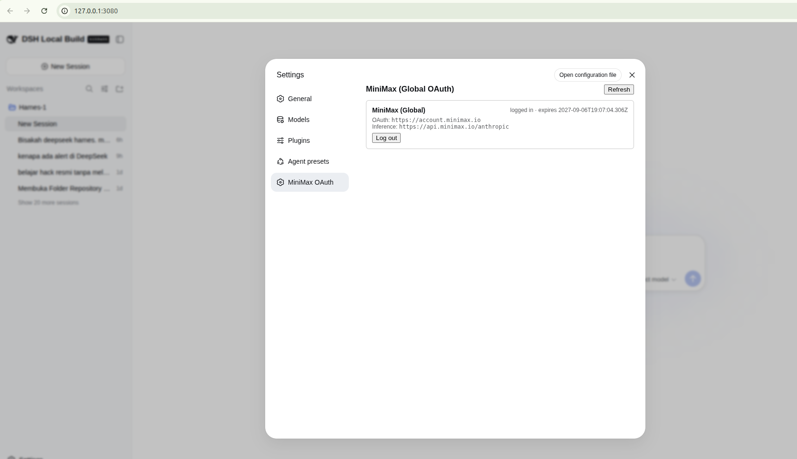
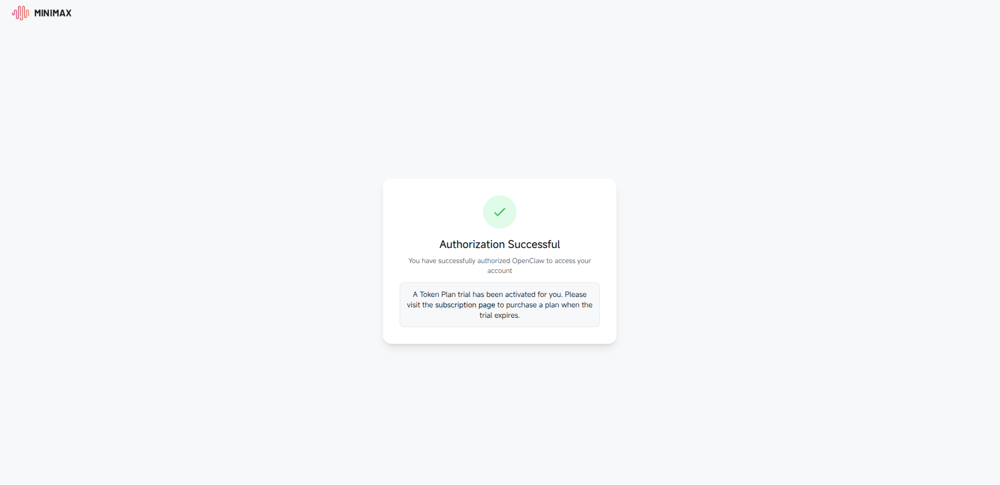

# dsh-llm-minimax-oauth

[](LICENSE)
[](https://github.com/deepseek-ai/deepseek-harness)
[](https://nodejs.org)
[](https://datatracker.ietf.org/doc/html/rfc8628)
[](https://platform.minimax.io)

DeepSeek Harness plugin: **MiniMax Global OAuth / Coding Plan** via browser login.

Registers the `minimax-portal` provider route on DSH's LLM runtime via a
custom `LlmAdapter`. The user authorizes once through a browser-based
device-code PKCE flow; tokens are persisted to
`$DSH_HOME/minimax-oauth.json`, refreshed transparently when close to
expiry, and serialized into the `DSH_MINIMAX_OAUTH_TOKEN_MINIMAX_PORTAL`
env var so the adapter can authenticate Anthropic Messages requests with
`Authorization: Bearer <oauth_access_token>` against
`https://api.minimax.io/anthropic/v1/messages`.

The built-in `pi-ai` `minimax` route (API-key path that reads
`MINIMAX_API_KEY` and sends `x-api-key`) is unchanged and remains
available for users who authenticate via API key. The OAuth path lives on
a separate route id so the two authentication channels never collide.

## Table of Contents

- [Prerequisites](#prerequisites)
- [Install](#install)
- [Use](#use)
- [Models unlocked](#models-unlocked)
- [Authentication](#authentication)
- [Troubleshooting](#troubleshooting)
- [Security](#security)
- [Uninstall](#uninstall)
- [For Plugin Authors](#for-plugin-authors)
- [API Reference](#api-reference)
- [Reference](#reference)
- [License](#license)

## Prerequisites

- **DeepSeek Harness** `0.1.1-rc.2` or compatible (any release exposing the
  `llm` and `webServer` cordis services)
- **Node.js** `^22.19.0` or `>=24.0.0`
- A MiniMax account with an active **Coding Plan** or **Credits** balance
  ([platform.minimax.io](https://platform.minimax.io))
- A modern browser with popups enabled (or willingness to copy the
  authorization URL manually — see [Troubleshooting](#browser-does-not-open-automatically))

## Install

The plugin is registered as a DSH bundle in your active profile's
`pnpm-workspace.yaml` and `cordis.patch.yml`. The fastest install is
through `dsh plugin`, which writes both files for you:

```sh
dsh plugin --profile web add /absolute/path/to/dsh-llm-minimax-oauth
# or, from inside the plugin checkout:
dsh plugin --profile web add .
```

Confirm the layer:

```sh
dsh --profile web --dump-config
```

A git install may ask you to allow `prepare` in the profile's
`pnpm-workspace.yaml` (pnpm ≥10 refuses lifecycle scripts otherwise):

```yaml
allowBuilds:
  dsh-llm-minimax-oauth: true
```

When the plugin ships via npm (future), the same command resolves the
package from your registry instead of the local path.

## Use

Open the Web UI at `http://127.0.0.1:3080`, go to Settings → MiniMax OAuth,
and click **Login with MiniMax**. A browser tab opens to the MiniMax OAuth
authorization page. Approve, then return to the settings panel — status flips
to "logged in" within ~5 seconds.

For headless / remote sessions, run the CLI fallback:

```sh
dsh-minimax-login              # interactive
dsh-minimax-login --no-browser # print URL, do not auto-open
dsh-minimax-login --logout     # clear stored token
```

After login, set the default model in `~/.dsh/settings.yaml`:

```yaml
agent-default-model:
  provider: minimax-portal
  model: MiniMax-M3
```

## Models unlocked

Provider `minimax-portal` (custom adapter in this plugin) at
`https://api.minimax.io/anthropic`, exposing `MiniMax-M3` (1M context,
vision, reasoning), `MiniMax-M2.7`, and `MiniMax-M2.7-highspeed`.

`MiniMax-M3` is the default and recommended for the Coding Plan.

## Screenshots

The Settings → MiniMax OAuth panel after a successful login:



The browser-side MiniMax authorization page (where the user pastes the
device code):



> **Maintaining the screenshots:** these PNGs live in `docs/screenshots/`
> and are not generated by the build. To update them, drop a fresh
> capture from a real DSH Web session into the matching path and commit.
> The repo intentionally ships without placeholder images so broken
> links surface immediately if a maintainer forgets to commit a new
> capture.

## Authentication

The plugin authenticates with `Authorization: Bearer <oauth_access_token>`,
matching the MiniMax Global OAuth contract documented at
<https://platform.minimax.io/docs/solutions/openclaw> and implemented in
OpenClaw's `extensions/minimax/provider-registration.ts`.

OAuth flow shape (device-code + PKCE S256 + state validation) is
byte-identical to OpenClaw's reference implementation:

- Device-code endpoint: `https://account.minimax.io/oauth2/device/code`
- Token endpoint: `https://account.minimax.io/oauth2/token`
- Client id: `78257093-7e40-4613-99e0-527b14b39113` (OpenClaw public client id)
- Scope: `group_id profile model.completion`
- Grant type: `urn:ietf:params:oauth:grant-type:user_code`
- Refresh grant: `refresh_token`

Tokens are persisted at `$DSH_HOME/minimax-oauth.json` (default
`~/.dsh/minimax-oauth.json`) and mirrored into the
`DSH_MINIMAX_OAUTH_TOKEN_MINIMAX_PORTAL` env var as a JSON envelope
(`{access, refresh, expires_at, inference_base_url, oauth_base_url}`).

### Flow at a glance

```
┌──────────┐  POST /minimax-oauth/start   ┌─────────┐
│          │ ──────────────────────────▶ │         │
│          │ ◀── { userCode,             │ Server  │
│  Client  │      verificationUri }      │  (DSH)  │
│  (Web)   │                             │         │
│   UI     │ window.open(verificationUri) │         │
│          │                             │         │
│          │  GET /minimax-oauth/status  │  polls  │
│          │ ──────────────────────────▶ │  /oauth2│
│          │ ◀── { logged_in: true }     │  /token │
│          │                             │         │
│          │ writes access_token into    │         │
│          │ env DSH_MINIMAX_OAUTH_TOKEN │         │
└──────────┘                             └─────────┘
                  Bearer auth ──────────────────▶ MiniMax /v1/messages
```

**Why two phases (not one)?** The browser-facing endpoint returns the
device code in <1 second. Token polling runs server-side in the
background and writes the credential to disk the moment authorization
succeeds. This keeps the HTTP connection short and avoids the
"Waiting for browser…" freeze that a blocking poll would cause.

## Troubleshooting

**Plugin loads but `/minimax-oauth/start` returns 405.** Check that the DSH
webserver route registration ran. See the build artifact — `lib/index.mjs`
must contain `ctx.effect(() => ctx.webServer.register({...}))`, not a detached
`const r = ctx.webServer.register; r(...)`. Rebuild with `pnpm run build` if
the bundle looks stale.

**Browser does not open automatically.** Popup blockers can prevent
`window.open`. Either allow popups for `127.0.0.1:3080` or use the manual
flow: copy the verification URL + user code from the Settings panel and
finish authorization in your browser.

**Login reports "Token Plan usage limit reached".** Account quota exhausted;
the OAuth handshake succeeded, but the model endpoint returned 429. Wait for
quota reset or upgrade the plan on MiniMax's Token Plan page.

**`MiniMax OAuth refresh failed: invalid_grant`.** The stored refresh token
was revoked or expired (server-side policy). Run `dsh-minimax-login --logout`
and re-authorize.

**`MiniMax OAuth timed out before authorization completed`.** The user did
not finish authorization within the device-code lifetime (default ~10 min).
Re-run the login flow.

**`dsh plugin add` fails with `prepare script denied`.** pnpm ≥10 refuses to
run install scripts by default. Edit the profile's `pnpm-workspace.yaml`
and add the `allowBuilds` snippet from [Install](#install).

## Security

- Tokens are persisted at `$DSH_HOME/minimax-oauth.json` with `0600` perms.
  Do not commit or share this file.
- The OAuth `refresh_token` is sensitive — anyone with access can mint
  access tokens until explicitly revoked from your MiniMax account settings.
- The plugin never logs full token values; the adapter logs only redacted
  previews during error paths.
- `DSH_MINIMAX_OAUTH_TOKEN_MINIMAX_PORTAL` is a process-local env var
  mirroring the persisted token; it is not exported or sourced from any
  shell rc file by this plugin.
- The plugin does not enable telemetry, analytics, or outbound network
  calls beyond the MiniMax OAuth endpoints and the model API.

## Uninstall

```sh
dsh plugin --profile web remove dsh-llm-minimax-oauth
```

Then remove the persisted credentials:

```sh
rm -f ~/.dsh/minimax-oauth.json
unset DSH_MINIMAX_OAUTH_TOKEN_MINIMAX_PORTAL
```

The built-in `pi-ai` `minimax` route (API-key path) is untouched and remains
usable after uninstall.

## For Plugin Authors

This plugin is a working reference for **registering routes through
`ctx.effect()`** in a DSH web bundle. Two patterns to copy:

```ts
// Direct method call — preserves `this` binding via the Reflect proxy.
// NEVER detach the reference (`const r = ctx.webServer.register; r(...)`),
// because the unbound method call crashes inside the WebServer with
// `Cannot read properties of undefined (reading 'exact')`.
ctx.effect(
  () => ctx.webServer.register({ kind: 'exact', path: '/your/path', handler: ... }),
  'descriptive-label',
)

// Client-side slot registration — `slots` must be declared in `inject`.
ctx.effect(
  () => ctx.slots.inject('your.slot.name', () =>
    ctx.slots.register({ name: 'your.slot.name', ... }, YourComponent)),
  'label',
)
```

The plugin also shows the **2-phase OAuth pattern**: server returns
device-code + user code immediately, browser opens the URL, polling
runs in the background. Avoid blocking the HTTP request on long-running
device-code flows.

## API Reference

`src/index.ts` exports the runtime pieces:

```ts
import {
  // LlmAdapter registered against the `minimax-portal` route
  MiniMaxAdapter,
  // File-backed token store with atomic writes
  FileCredentialStore,
  // OAuth error class with stable `.code` values
  MiniMaxOAuthError,
  // OAuth helpers (2-phase)
  startAuthorization,  // phase 1: request device code, return userCode + verificationUri
  waitForToken,        // phase 2: poll for token, persist state
  // Access helpers
  resolveAccessToken,   // returns a valid access_token, refreshing if expired
  refreshAccessToken,   // force-refresh using stored refresh_token
  // Token envelope serialization (for env var mirroring)
  readSerializedToken,
  // Constants
  MINIMAX_PROVIDER_ID, MINIMAX_INFERENCE_ENV_VAR,
  MINIMAX_DEFAULT_MODEL_CATALOG, ...,
} from 'dsh-llm-minimax-oauth'
```

The `dsh.client` slot registration lives in `src/client/apply.ts`. The
React UI for the Settings panel is in `src/client/index.tsx`.

## Reference

OAuth flow shape mirrors OpenClaw's reference implementation:
<https://github.com/openclaw/openclaw/blob/main/extensions/minimax/oauth.ts>

Endpoint URLs, scope, client id, PKCE method, grant type, and
refresh-token handling are identical.

## License

[MIT](LICENSE) — Copyright (c) 2026 Bambang Saputra Jaya.
